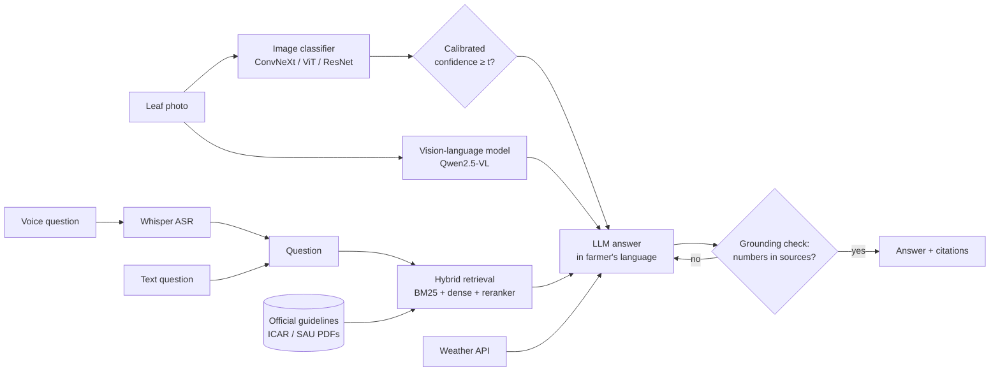

# 🌱 AgriSight

*Crop disease diagnosis that works in real fields, and advice that never invents a dose.*

**Plant disease diagnosis that holds up on real field photos, plus a grounded,
multilingual AI assistant for farmers.**

Models trained on lab datasets like PlantVillage report ~99% accuracy, then fail on
real phone photos taken in a field. General-purpose LLMs give confident farm advice,
including pesticide doses they made up. AgriSight studies and fixes both problems:

1. **Vision (deep learning):** measure the lab → field accuracy gap and close it with
   field-style augmentation, stronger backbones and unsupervised domain adaptation.
2. **Trust (ML):** calibrated confidence, so the model says *"not sure, take a closer
   photo"* instead of guessing.
3. **Generative AI:** a vision-language model describes the symptoms; an LLM answers
   in the farmer's language using **only** retrieved official guidelines, with citations
   and an automatic check that blocks numbers not found in the sources.
4. **Deployment:** distillation + int8 quantization for offline use on cheap phones,
   a REST API, and a Streamlit demo with photo and voice input.

> Status: research prototype. Results tables live in [docs/EXPERIMENTS.md](docs/EXPERIMENTS.md)
> and are filled in as experiments are run.

## Architecture



## Research questions

| # | Question | Script |
|---|---|---|
| RQ1 | How big is the lab → field gap, and which of augmentation, backbone and domain adaptation (AdaBN, DANN) closes it most? | `train.py`, `evaluate.py`, `domain_adapt.py` |
| RQ2 | Is the model's confidence trustworthy on field photos, and how many errors does abstaining catch? | `evaluate.py` |
| RQ3 | On field photos, is a fine-tuned classifier, a zero-shot VLM, or a hybrid better? | `eval/vlm_vs_classifier.py` |
| RQ4 | Does RAG + a grounding check reduce hallucinated advice? Which retrieval setup works best? | `eval/rag_eval.py` |
| RQ5 | How small and fast can the model get without losing field accuracy? | `train.py --teacher`, `compress.py` |

## Repository layout

```
configs/            default.yaml (all settings), label_map.yaml (28 shared classes)
scripts/            download_data.sh, prepare_data.py
src/agrisight/
  data.py           datasets + field-style augmentation
  models.py         timm backbones, checkpoint I/O
  train.py          training (AMP, cosine LR, early stopping, knowledge distillation)
  evaluate.py       accuracy, macro-F1, ECE, temperature scaling, risk-coverage, AdaBN
  domain_adapt.py   AdaBN + DANN (gradient reversal)
  compress.py       ONNX export, int8 quantization, latency benchmark
  predict.py        single-image inference with abstention
  vlm.py            Qwen2.5-VL via Ollama or transformers
  llm.py            OpenAI-compatible chat client (Ollama, vLLM, OpenAI, Groq...)
  rag/              chunking, index building, hybrid retriever
  agent/            assistant pipeline, weather tool, grounding check
  speech.py         Whisper ASR, optional text-to-speech
  api.py            FastAPI service
app/                Streamlit demo
eval/               RQ3 and RQ4 evaluation scripts + sample questions
knowledge_base/     guideline documents for RAG (replace the examples!)
docs/               PLAN.md (8-week plan), EXPERIMENTS.md (result tables)
notebooks/          Colab quickstart
tests/              unit tests (run in CI)
```

## Quickstart

### 1. Install
```bash
git clone https://github.com/<you>/agrisight.git && cd agrisight
python -m venv .venv && source .venv/bin/activate
pip install -r requirements.txt
pip install -e .
```

### 2. Data (see [data/README.md](data/README.md))
```bash
bash scripts/download_data.sh
python scripts/prepare_data.py \
    --plantvillage data/raw/PlantVillage-Dataset/raw/color \
    --plantdoc data/raw/PlantDoc-Dataset
```

### 3. Train and evaluate the vision model
```bash
python -m agrisight.train --run-name convnext_field_aug
python -m agrisight.evaluate --ckpt runs/convnext_field_aug/best.pt --save-temperature
```
`evaluate` prints a table for lab and field, saves `eval.json` and confusion matrices,
and reports the lab → field gap.

### 4. Generative AI components
```bash
# Local models via Ollama (https://ollama.com)
ollama pull qwen2.5:7b-instruct
ollama pull qwen2.5vl:7b

# Build the retrieval index from knowledge_base/
python -m agrisight.rag.index
```
To use a hosted API instead, set `llm.base_url` / `llm.model` in `configs/default.yaml`
and export `LLM_API_KEY`. To run the VLM inside Python (e.g. on Colab), set
`vlm.backend: hf`.

### 5. Run the app or the API
```bash
export AGRISIGHT_CKPT=runs/convnext_field_aug/best.pt
streamlit run app/streamlit_app.py
# or
uvicorn agrisight.api:app --port 8000      # interactive docs at /docs
curl -F image=@leaf.jpg -F question="What should I do?" -F language=te http://localhost:8000/ask
```
Every component is optional: without a checkpoint the VLM diagnoses alone; without
an index the assistant refuses to give treatment details.

### 6. Experiments
All commands and result tables: [docs/EXPERIMENTS.md](docs/EXPERIMENTS.md).

### Tests
```bash
pytest -q
```

## Results

| Experiment | Result |
|---|---|
| Lab → field gap (best baseline) | _to fill_ |
| Field accuracy after augmentation + adaptation | _to fill_ |
| Errors caught by abstention at 0.6 | _to fill_ |
| Answers with unsupported numbers: LLM only → RAG | _to fill_ |
| Phone model size / latency | _to fill_ |

## Safety and limitations

- Decision support only. Advice must come from official sources; the assistant is
  told to refer farmers to the local Krishi Vigyan Kendra (KVK) when unsure.
- The files in `knowledge_base/` are **placeholders**. Replace them with official
  ICAR / state agricultural university documents before any real use.
- PlantDoc is small and web-sourced, so it only approximates Indian field conditions.
  A locally collected, expert-labelled test set is the most valuable next step.

## Acknowledgements

PlantVillage (Hughes & Salathé), PlantDoc (Singh et al., 2020), timm, Hugging Face,
Qwen2.5-VL, BGE embeddings, Open-Meteo, Ollama.

## License

MIT
